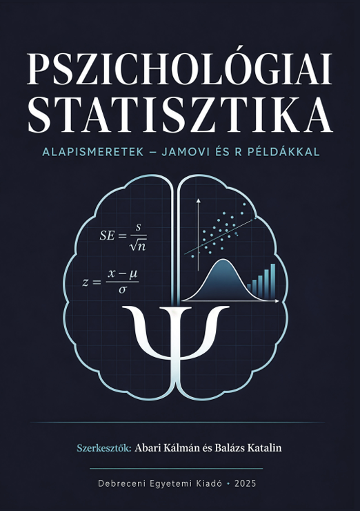

# Quarto-dokumentumok: egy elemzés, öt kimenet

<a href="https://dupress.unideb.hu/hu/termek/pszichologiai-statisztika-alapismeretek-jamovi-es-r-peldakkal/">
  
</a>

Ez a repó a **Pszichológiai statisztika, alapismeretek – jamovi és R példákkal** című könyv 10. fejezetének mellékanyaga.

> Abari Kálmán és Balázs Katalin (szerk.):
> *Pszichológiai statisztika, alapismeretek – jamovi és R példákkal.*
> Debreceni Egyetemi Kiadó, 2025. ISBN 978-963-615-364-9.
> Szerzők: Abari Kálmán, Balázs Katalin, Hőgye-Nagy Ágnes, Hujber-Mitru Szilvia, Kegyes Lilla, Kurucz Győző, Máth János.

A könyv ingyenesen letölthető a [Debreceni Egyetemi Kiadó oldaláról](https://dupress.unideb.hu/hu/termek/pszichologiai-statisztika-alapismeretek-jamovi-es-r-peldakkal/).

A fejezet azt mutatja be, hogyan lesz egy R-ben végzett adatelemzésből publikálható, reprodukálható dokumentum a [Quarto](https://quarto.org) segítségével. A repóban ugyanaz a kutatási beszámoló öt különböző `.qmd` állományban szerepel, és mindegyikből más formátumú dokumentum készül. Így jól összevethető, mit kell a fejlécben (YAML) beállítani az egyes kimeneti formátumokhoz.

## Mit tartalmaz a repó?

### A Quarto-dokumentumok

Az öt állomány szövege és R-kódja szó szerint azonos, csak a fejlécük különbözik.

| Állomány | Kimenet | Jellemzők |
|---|---|---|
| `elemzes_html.qmd` | `elemzes_html.html` | Cerulean téma, bal oldali tartalomjegyzék, összecsukható kód, önálló (offline is működő) HTML |
| `elemzes_docx.qmd` | `elemzes_docx.docx` | Word-dokumentum a repó saját tudományos sablonjával |
| `elemzes_pdf.qmd` | `elemzes_pdf.pdf` | PDF LaTeX-hel (LuaLaTeX, Libertinus betűtípus) |
| `elemzes_typst.qmd` | `elemzes_typst.pdf` | PDF Typsttel: gyors fordítás, LaTeX nélkül |
| `elemzes_mix.qmd` | `elemzes_mix.html`, `.docx`, `.pdf` | egyetlen forrásból három formátum (HTML, Word, Typst) |

### A kutatási beszámoló tartalma

A dokumentumok az `adat/` könyvtár három Excel-állományát elemzik.

- **Star Wars szereplők** (`starwars.xlsx`): leíró statisztikák, fajonkénti testmagasság-táblázat, a magasság és a tömeg kapcsolata ábrával és Pearson-féle korrelációval, a kiugró érték (Jabba) hatásával együtt.
- **Flow-kérdőív** (`flow.xlsx`, `flow2.xlsx`): a minta jellemzése, a flow-pontszám kiszámítása a 20 tétel átlagaként, majd annak ellenőrzése, hogy egyezik-e a `flow2.xlsx`-ben tárolt értékkel. Végül egy hipotézisvizsgálat: különbözik-e az alkotó tevékenységet végzők és nem végzők flow-pontszáma (Welch-féle *t*-próba, Cohen-féle *d*).

A dokumentumokban a könyvben tárgyalt Quarto-elemek mindegyike szerepel:

- YAML-fejléc;
- Markdown-formázás és -táblázat;
- R-csonkok és beágyazott (inline) R-kód;
- ábrák és táblázatok kereszthivatkozással (`[-@tbl-…]. táblázat`);
- szövegközi hivatkozások és irodalomjegyzék.

A szövegben szereplő számokat (átlagok, *p*-értékek, a hipotézisről szóló döntés) az R számolja ki fordításkor, ezért az adatok változásakor a szöveg is frissül.

### Segédállományok

```
adat/           az elemzett adatállományok (Excel)
hivatkozasok/   bibliográfia (hivatkozasok.bib) és magyar APA hivatkozási stílus (apahun.csl)
nyelv/          magyar feliratok a Quarto számára (hungarian.yml)
stilus/         HTML-stíluslap, valamint LaTeX- és Typst-beállítások a feliratokhoz
szurok/         Lua-szűrők a magyar ábra- és táblázatcímekhez és a Word-kimenethez
sablon/         a Word-sablon és az azt előállító R-szkript
kepek/          a README képei (a könyv borítója)
```

| Állomány | Szerepe | Melyik kimenet használja |
|---|---|---|
| `nyelv/hungarian.yml` | magyar feliratok: „Tartalomjegyzék”, „táblázat”, „ábra” stb. | mind |
| `hivatkozasok/hivatkozasok.bib` | a hivatkozott művek adatai | mind |
| `hivatkozasok/apahun.csl` | APA 7 hivatkozási stílus magyar beállításokkal | mind |
| `stilus/style.css` | pont a fejezetszámok után, balra igazított képaláírások | HTML |
| `stilus/pdf-feliratok.tex` | képaláírások formázása, pont a szakaszszámok után a tartalomjegyzékben | PDF |
| `stilus/typst-feliratok.typ` | magyar képaláírások Typstben | Typst |
| `szurok/caption.lua` | „Táblázat 1:” helyett „**1. táblázat.** *Cím*” | HTML, Word |
| `szurok/docx-sablon.lua` | pont a szakaszszámok után („3.1.”), záróvonal a táblázatok alatt | Word |
| `sablon/tudomanyos_sablon.docx` | Word-sablon (`reference-doc`) | Word |
| `sablon/sablon_keszites.R` | ez a szkript állítja elő a Word-sablont | – |

A képaláírások minden formátumban a magyar szokás szerint jelennek meg: félkövér címke, utána dőlt cím, balra igazítva. Például: **1. táblázat.** *A legalább három szereplővel képviselt fajok testmagassága (cm)*.

### A Word-sablon

A `sablon/tudomanyos_sablon.docx` modern, de tudományos megjelenésű sablon:

- a kenyérszöveg Cambria 11 pt, sorkizárt, 1,15-ös sorközzel;
- a címsorok Calibri betűsek, sötétkék és acélkék színűek;
- a táblázatok APA-stílusúak, csak vízszintes vonalakkal;
- A4-es oldalméret, 2,5 cm-es margók, oldalszám a láblécben.

A sablont nem kézzel szerkesztettük, hanem a `sablon/sablon_keszites.R` szkript állítja elő a Pandoc alapértelmezett sablonjából. A színek vagy a betűtípusok átírása után a szkriptet a projekt gyökeréből futtatva új sablon készül:

```r
source("sablon/sablon_keszites.R")
```

## Használat

### Szükséges programok

- [R](https://cran.r-project.org) (4.x) és [RStudio](https://posit.co/download/rstudio-desktop/) (vagy Positron)
- [Quarto](https://quarto.org/docs/get-started/) (1.4 vagy újabb; a Typst-fordító már benne van)
- R-csomagok:

  ```r
  install.packages(c("tidyverse", "rio", "gt", "knitr", "effectsize", "quarto", "zip"))
  ```

- PDF-kimenethez (LaTeX) TinyTeX: `quarto install tinytex`. A Typst-kimenethez nincs szükség LaTeX-re.

### Fordítás

1. Töltsük le a repót (**Code / Download ZIP**), vagy klónozzuk:

   ```bash
   git clone https://github.com/abarik/quarto_dokumentumok.git
   ```

2. Nyissuk meg a `quarto_dokumentumok.Rproj` projektet az RStudióban.
3. Nyissuk meg valamelyik `elemzes_*.qmd` állományt, és nyomjuk meg a **Render** gombot (Ctrl+Shift+K).

A fordítás parancssorból (RStudióban a **Terminal** fülön) vagy az R-konzolból, a {quarto} csomaggal is elindítható. Az alábbi parancsokat a projekt gyökerében kell kiadni.

#### Az egyformátumú dokumentumok

Ezeknek a fejlécében egyetlen formátum szerepel, így nem kell megadni, mit kérünk.

| Állomány | Parancssor | R-konzol | Kimenet |
|---|---|---|---|
| HTML | `quarto render elemzes_html.qmd` | `quarto::quarto_render("elemzes_html.qmd")` | `elemzes_html.html` |
| Word | `quarto render elemzes_docx.qmd` | `quarto::quarto_render("elemzes_docx.qmd")` | `elemzes_docx.docx` |
| PDF (LaTeX) | `quarto render elemzes_pdf.qmd` | `quarto::quarto_render("elemzes_pdf.qmd")` | `elemzes_pdf.pdf` |
| PDF (Typst) | `quarto render elemzes_typst.qmd` | `quarto::quarto_render("elemzes_typst.qmd")` | `elemzes_typst.pdf` |

#### A vegyes dokumentum (`elemzes_mix.qmd`)

Az `elemzes_mix.qmd` fejlécében három formátum szerepel (`html`, `docx`, `typst`). Formátum megadása nélkül mindhárom elkészül, a `--to` kapcsolóval (R-ben az `output_format` argumentummal) pedig kiválaszthatjuk, melyik kimenetet kérjük.

Minden kimenet egyszerre (`elemzes_mix.html`, `elemzes_mix.docx` és `elemzes_mix.pdf`):

```bash
quarto render elemzes_mix.qmd
```

```r
quarto::quarto_render("elemzes_mix.qmd", output_format = "all")
```

Csak egy kimenet:

```bash
quarto render elemzes_mix.qmd --to html      # elemzes_mix.html
quarto render elemzes_mix.qmd --to docx      # elemzes_mix.docx
quarto render elemzes_mix.qmd --to typst     # elemzes_mix.pdf
```

```r
quarto::quarto_render("elemzes_mix.qmd", output_format = "html")
quarto::quarto_render("elemzes_mix.qmd", output_format = "docx")
quarto::quarto_render("elemzes_mix.qmd", output_format = "typst")
```

Kettő a három közül (például HTML és Word):

```bash
quarto render elemzes_mix.qmd --to html,docx
```

```r
quarto::quarto_render("elemzes_mix.qmd", output_format = c("html", "docx"))
```

Az RStudio **Render** gombja a vegyes dokumentumnál csak egy formátumot fordít le, alapértelmezés szerint a fejlécben elsőként szereplőt (HTML). A gomb melletti lenyíló menüben választhatunk a három formátum közül. Az összes kimenethez a fenti parancsokat használjuk.

A lefordított dokumentumok a `.qmd` állományok mellé, a projekt gyökerébe kerülnek. A repó ezeket nem tárolja (lásd `.gitignore`), hiszen bármikor újra előállíthatók.

## Licenc

MIT, lásd a [LICENSE](LICENSE) állományt.
